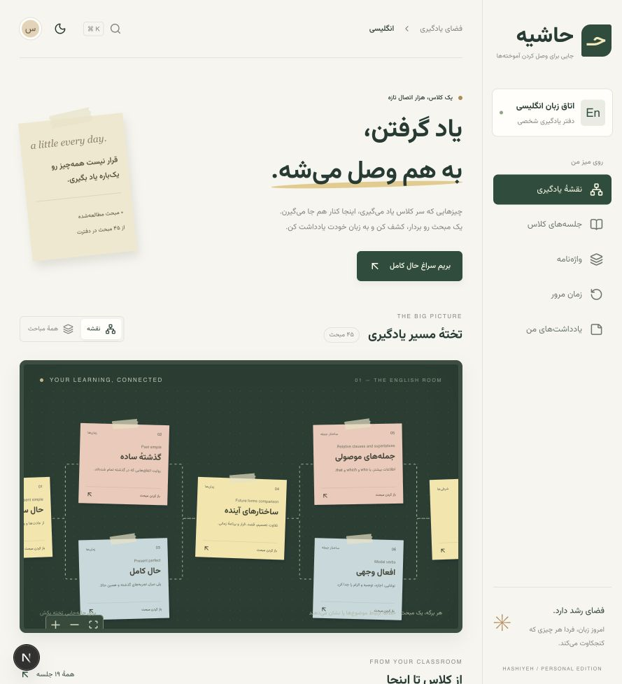
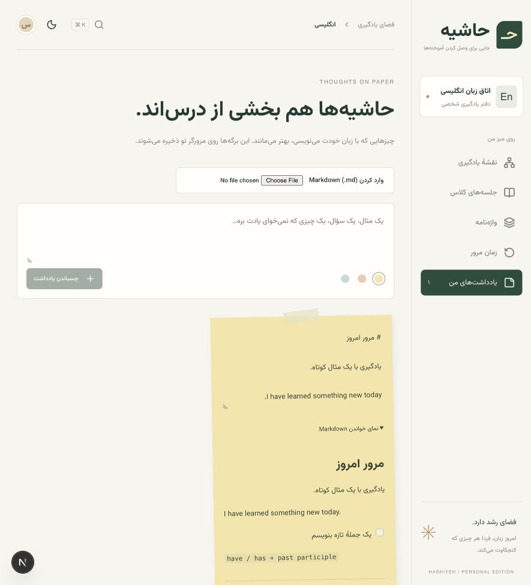

<div align="center">

# حاشیه

### جایی برای وصل کردن آموخته‌ها

**تختهٔ شخصی یادگیری · گراف دانش · جزوه‌های دوزبانه**

[](README.md)
[](README.fa.md)


[راهنمای Markdown](docs/MARKDOWN.md) · [استقرار](docs/DEPLOYMENT.md) · [معماری](docs/APP-ARCHITECTURE.md)

</div>



<details>
<summary>دیدن فضای یادداشت‌های دوزبانه</summary>



</details>

> نسخهٔ اول اجرایی، بر پایهٔ جزوه‌های واقعی کلاس.

---

<div dir="rtl">

**حاشیه، دفتر شخصی یادگیری توست.** مطالبی که در کلاس و گفت‌وگو یاد می‌گیری، روی یک تختهٔ دیجیتال کنار هم قرار می‌گیرند: از شناخت ارتباط موضوع‌ها تا خواندن جزوه، تمرین و نوشتن با زبان خودت.

### داخل این اتاق

| تجربه | قابلیت |
| :--- | :--- |
| 🗺 نقشهٔ یادگیری | برگه‌های متصل، جابه‌جایی و بزرگ‌نمایی؛ نمای فهرست برای همهٔ مباحث |
| 📖 جزوهٔ کلاس | متن کامل پاسخ‌های مرتبط، همراه شناسهٔ منبع |
| 📝 Markdown | واردکردن فایل در یادداشت‌های شخصی یا افزودن آن به محتوای مخزن |
| ↔ متن دوزبانه | جهت مستقل پاراگراف‌ها، عنوان‌ها، فهرست‌ها و سلول‌های جدول؛ کد همیشه چپ‌چین |
| 🗂 واژه‌نامه | جست‌وجوی فارسی/انگلیسی، خانوادهٔ واژه و تلفظ دستگاه |
| 🔁 مرور | فلش‌کارت با زمان‌بندی سادهٔ یک‌روزه و سه‌روزه |
| 🟨 حاشیه‌نویسی | استیکی‌نوت قابل ویرایش، رنگ‌بندی و خروجی JSON |
| ✳ همراه مطالعه | اتصال اختیاری Groq با تکیه بر جزوهٔ انتخابی |

مجموعهٔ اولیه شامل **۴۵ مبحث، ۱۹ جلسه و ۱۳۰۳ واژه** است. هفت تمرین تکمیلی جداگانه تألیف شده‌اند. خط‌های نمای منتخب گراف، ارتباط بصری موضوع‌ها هستند و پیش‌نیاز تأییدشده محسوب نمی‌شوند.

### شروع سریع

Node.js 22 و npm لازم است. دستورهای زیر را در ریشهٔ پروژه اجرا کن:

</div>

```sh
npm ci
npm run dev
```

<div dir="rtl">

سایت روی `http://127.0.0.1:3000` اجرا می‌شود. در توسعهٔ محلی ورود لازم نیست؛ نسخهٔ production به رمز و secret نیاز دارد.

### تنظیمات خصوصی

از `.env.example` یک `.env.local` بساز. مقادیر واقعی را در Git ثبت نکن.

| متغیر | کاربرد |
| --- | --- |
| `SITE_PASSWORD` | رمز فضای شخصی در production |
| `SESSION_SECRET` | secret تصادفی حداقل ۳۲ نویسه‌ای |
| `GROQ_API_KEY` | اختیاری؛ فعال‌سازی همراه مطالعه |
| `GROQ_MODEL` | مدل انتخابی سرویس |

برای Vercel، همین متغیرها را در تنظیمات محیطی پروژه قرار بده. مخزنِ حاوی گفت‌وگوها و جزوه‌های شخصی را خصوصی نگه دار. [راهنمای کامل استقرار](docs/DEPLOYMENT.md)

### مسیر محتوای تازه

۱. فایل را بر اساس [قالب Markdown](templates/lesson.md) بنویس.
۲. از صفحهٔ «یادداشت‌های من» یا حاشیه‌های یک درس، فایل `.md` را وارد کن؛ این مسیر در همان مرورگر ذخیره می‌شود.
۳. برای افزودن جزوه به محتوای نسخه‌دار GitHub، از فرمان زیر استفاده کن. اجرای اول فقط اعتبارسنجی است:

</div>

```sh
npm run import:markdown -- templates/lesson.md concept-present-perfect note-md-my-lesson
# Save only after reviewing the dry run:
npm run import:markdown -- templates/lesson.md concept-present-perfect note-md-my-lesson --write
npm run validate
```

<div dir="rtl">

پس از تغییر محتوای مخزن، سرور توسعه را دوباره اجرا کن یا نسخهٔ تازه deploy کن. این نسخه Markdown استاندارد و GFM را پشتیبانی می‌کند؛ سازگاری کامل با vault و افزونه‌های Obsidian ادعا نمی‌شود. [حدود پشتیبانی و راهنمای نوشتن](docs/MARKDOWN.md)

</div>

<div dir="rtl">

### معماری، در یک نگاه

| لایه | مسیر | مسئولیت |
| --- | --- | --- |
| محتوا | `content/` و `schemas/` | رکوردها، ارتباط‌ها و اعتبارسنجی |
| ورود و خروج | `imports/` و `scripts/` | منابع استخراج‌شده و آداپتورهای انتقال داده |
| سرور | `app/lib/repository.ts` و `app/api/` | خواندن امن محتوا و اتصال دستیار |
| رابط | `app/components/` | اجزای مستقل تخته، درس، واژگان، مرور و یادداشت |
| ارائه | `app/lib/presentation.ts` | دسته‌بندی، نام‌ها و چیدمان گراف |
| پیشرفت شخصی | `app/components/usePersonal.ts` | ذخیرهٔ نسخه‌دار در مرورگر |

### بررسی و ساخت

</div>

```sh
npm test
npm run typecheck
npm run build
npm run test:app
npm start
```

<div dir="rtl">

`test:app` به build موجود نیاز دارد و ورود و دسترسی API را روی سرور واقعی بررسی می‌کند.

### محدودیت‌های فعلی

یادداشت‌ها میان دستگاه‌ها یا دامنه‌های preview و production همگام نمی‌شوند. فایل واردشده از مرورگر محلی است؛ برای افزودن به محتوای GitHub از فرمان واردکردن استفاده کن. دستیار، پاسخ‌دهی با زمینهٔ جزوه است و سامانهٔ کامل جست‌وجوی برداری نیست. صحت متن‌های استخراج‌شده باید جداگانه بازبینی شود.

قرارداد داده برای درس‌های دیگر قابل گسترش است؛ رابط فعلی برای اتاق انگلیسی تنظیم شده و اتاق دوم به انتخاب موضوع و فیلتر داده نیاز دارد.

### دفتر مستندات

[معماری](docs/APP-ARCHITECTURE.md) · [استقرار](docs/DEPLOYMENT.md) · [قرارداد داده](docs/DATA-CONTRACT.md) · [روند هفتگی](docs/WEEKLY-WORKFLOW.md) · [استخراج](docs/EXTRACTION.md) · [فهرست گفت‌وگو](docs/CHAT-INDEX.md)

</div>

---

<div align="center">

**هر روز کمی یادگیری؛ هر هفته یک اتصال تازه.**

[English →](README.md)

</div>
