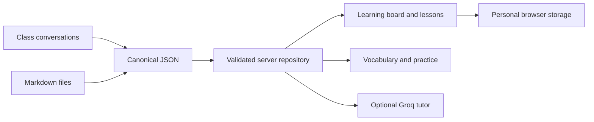

<div align="center">

# حاشیه · HASHIYEH

### A quiet place for connected learning
### هر آموخته، یک اتصال تازه

**Personal learning board · Knowledge graph · Bilingual notes**


[فارسی](#فارسی) · [English](#english) · [Markdown guide](docs/MARKDOWN.md) · [Deployment](docs/DEPLOYMENT.md)

</div>


<details>
<summary>Markdown workspace · فضای یادداشت دوزبانه</summary>


</details>

> A working first edition, built around real class notes. / نسخهٔ اول اجرایی، بر پایهٔ جزوه‌های واقعی کلاس.

---

## فارسی

<div dir="rtl">

**حاشیه، دفتر شخصی یادگیری توست.** مطالبی که در کلاس و گفت‌وگو یاد می‌گیری، روی یک تختهٔ دیجیتال کنار هم قرار می‌گیرند: از شناخت ارتباط موضوع‌ها تا خواندن جزوه، تمرین و نوشتن با زبان خودت.

### داخل این اتاق

| تجربه | قابلیت |
| :--- | :--- |
| 🗺 نقشهٔ یادگیری | برگه‌های متصل، جابه‌جایی و بزرگ‌نمایی؛ نمای فهرست برای همهٔ مباحث |
| 📖 جزوهٔ کلاس | متن کامل پاسخ‌های مرتبط، همراه شناسهٔ منبع |
| 📝 Markdown | واردکردن فایل در یادداشت‌های شخصی یا افزودن آن به محتوای مخزن |
| ↔ متن دوزبانه | جهت مستقل پاراگراف‌ها، عنوان‌ها، فهرست‌ها و سلول‌های جدول؛ کد همیشه چپ‌چین |
| 🗂 واژه‌نامه | جست‌وجوی فارسی/انگلیسی، خانوادهٔ واژه و تلفظ دستگاه |
| 🔁 مرور | فلش‌کارت با زمان‌بندی سادهٔ یک‌روزه و سه‌روزه |
| 🟨 حاشیه‌نویسی | استیکی‌نوت قابل ویرایش، رنگ‌بندی و خروجی JSON |
| ✳ همراه مطالعه | اتصال اختیاری Groq با تکیه بر جزوهٔ انتخابی |

مجموعهٔ اولیه شامل **۴۵ مبحث، ۱۹ جلسه و ۱۳۰۳ واژه** است. هفت تمرین تکمیلی جداگانه تألیف شده‌اند. خط‌های نمای منتخب گراف، ارتباط بصری موضوع‌ها هستند و پیش‌نیاز تأییدشده محسوب نمی‌شوند.

### شروع سریع

Node.js 22 و npm لازم است. دستورهای زیر را در ریشهٔ پروژه اجرا کن:

</div>

```sh
npm ci
npm run dev
```

<div dir="rtl">

سایت روی `http://127.0.0.1:3000` اجرا می‌شود. در توسعهٔ محلی ورود لازم نیست؛ نسخهٔ production به رمز و secret نیاز دارد.

### تنظیمات خصوصی

از `.env.example` یک `.env.local` بساز. مقادیر واقعی را در Git ثبت نکن.

| متغیر | کاربرد |
| --- | --- |
| `SITE_PASSWORD` | رمز فضای شخصی در production |
| `SESSION_SECRET` | secret تصادفی حداقل ۳۲ نویسه‌ای |
| `GROQ_API_KEY` | اختیاری؛ فعال‌سازی همراه مطالعه |
| `GROQ_MODEL` | مدل انتخابی سرویس |

برای Vercel، همین متغیرها را در تنظیمات محیطی پروژه قرار بده. مخزنِ حاوی گفت‌وگوها و جزوه‌های شخصی را خصوصی نگه دار. [راهنمای کامل استقرار](docs/DEPLOYMENT.md)

### مسیر محتوای تازه

۱. فایل را بر اساس [قالب Markdown](templates/lesson.md) بنویس.
۲. از صفحهٔ «یادداشت‌های من» یا حاشیه‌های یک درس، فایل `.md` را وارد کن؛ این مسیر در همان مرورگر ذخیره می‌شود.
۳. برای افزودن جزوه به محتوای نسخه‌دار GitHub، از فرمان زیر استفاده کن. اجرای اول فقط اعتبارسنجی است:

</div>

```sh
npm run import:markdown -- templates/lesson.md concept-present-perfect note-md-my-lesson
# Save only after reviewing the dry run:
npm run import:markdown -- templates/lesson.md concept-present-perfect note-md-my-lesson --write
npm run validate
```

<div dir="rtl">

پس از تغییر محتوای مخزن، سرور توسعه را دوباره اجرا کن یا نسخهٔ تازه deploy کن. این نسخه Markdown استاندارد و GFM را پشتیبانی می‌کند؛ سازگاری کامل با vault و افزونه‌های Obsidian ادعا نمی‌شود. [حدود پشتیبانی و راهنمای نوشتن](docs/MARKDOWN.md)

</div>

---

## English

**Hashiyeh is a personal learning workspace that connects what you learn.** A paper-inspired board brings together class notes, related concepts, vocabulary, practice and personal reflections.

### Designed for the learning loop

**Explore → Read → Practice → Reflect → Review**

- **Connected board:** pan and zoom through selected topics; browse all topics in a searchable interface.
- **Source-backed lessons:** read the captured class explanations without silently rewriting the original material.
- **Bilingual Markdown:** independent text direction per block, GFM tables, task lists, fenced code and local Markdown import.
- **Personal workspace:** editable sticky notes, bookmarks, completion state, theme and review scheduling in browser storage.
- **Optional tutor:** a server-side Groq endpoint uses selected lesson notes as context. It needs a configured API key.
- **Responsive motion:** GSAP transitions and React Flow navigation, with reduced-motion support.

### Run and verify

```sh
npm ci
npm run dev            # http://127.0.0.1:3000
npm test               # Data integrity and extraction checks
npm run typecheck      # TypeScript checks
npm run build          # Validate content and build production
npm run test:app       # Production HTTP/auth smoke tests; requires a build
npm start              # Run the production build
```

### Architecture at a glance



| Layer | Location | Responsibility |
| --- | --- | --- |
| Content | `content/`, `schemas/` | Versioned records, relationships and validation |
| Imports | `imports/`, `scripts/` | Captured evidence and explicit import/export workflows |
| Server | `app/lib/repository.ts`, `app/api/` | Protected content access and tutor integration |
| Interface | `app/components/` | Independent board, lesson, notes, review and vocabulary components |
| Presentation | `app/lib/presentation.ts` | Labels, selected graph layout and visual categories |
| Personal state | `app/components/usePersonal.ts` | Versioned browser storage and export |

### Deployment & boundaries

Use a **private GitHub repository** and import it into Vercel with the Next.js preset. Set `SITE_PASSWORD` and a random `SESSION_SECRET` of at least 32 characters. Production content access stays closed until both are configured. Add `GROQ_API_KEY` only in server environment settings; never use a `NEXT_PUBLIC_` prefix for secrets.

Personal notes do **not** synchronize across devices or preview/production domains. Markdown imported in the browser stays local; the CLI import writes canonical repository content. The tutor is contextual assistance, not a complete vector-search/RAG system. Imported educational material remains unreviewed until explicitly checked.

The data contract supports additional subjects; the current interface is configured for English. A second learning room needs subject selection and repository filtering. This is a working foundation, not a claim of showcase-ready completion.

### Project notebook

[Architecture](docs/APP-ARCHITECTURE.md) · [Deployment](docs/DEPLOYMENT.md) · [Markdown](docs/MARKDOWN.md) · [Data contract](docs/DATA-CONTRACT.md) · [Weekly workflow](docs/WEEKLY-WORKFLOW.md) · [Extraction](docs/EXTRACTION.md) · [Conversation index](docs/CHAT-INDEX.md)

---

<div align="center">

**A little every day. A new connection every week.**

هر روز کمی یادگیری؛ هر هفته یک اتصال تازه.

</div>
