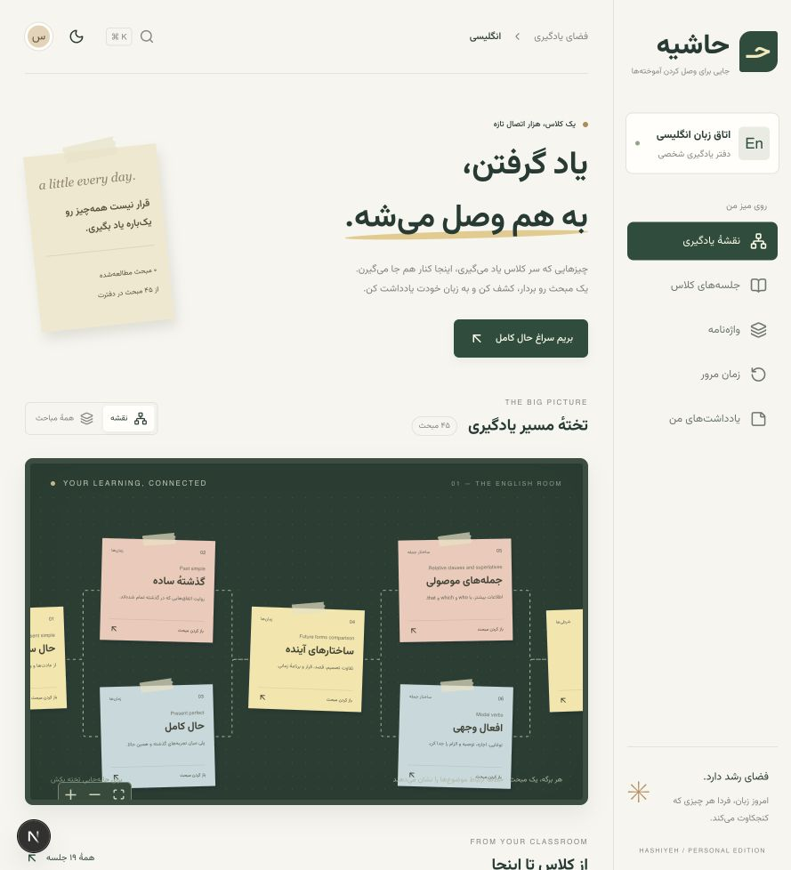
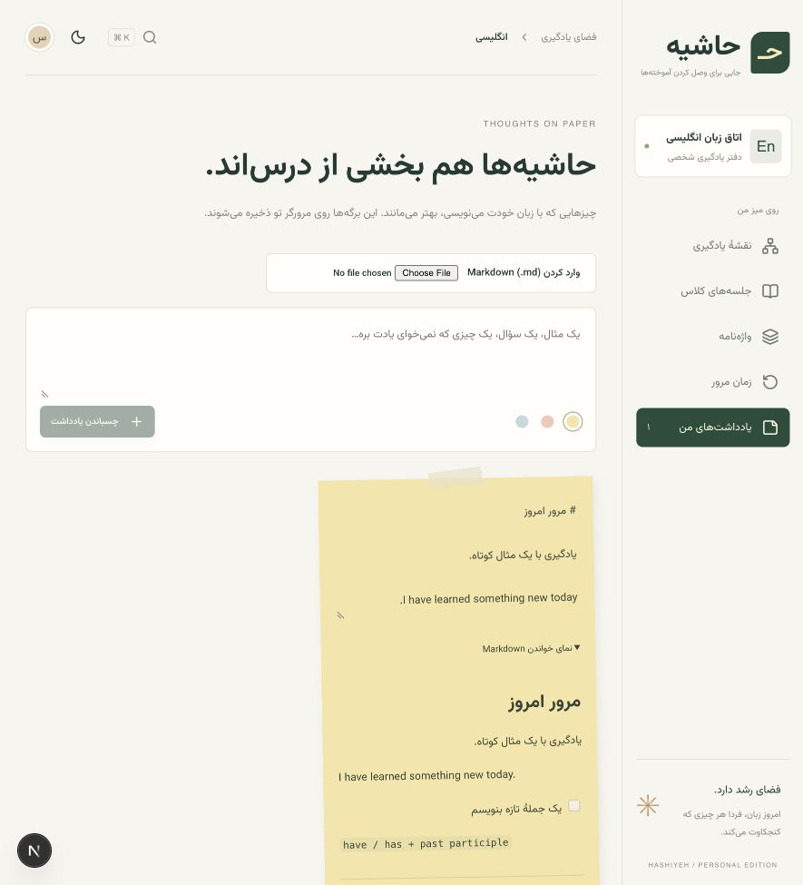
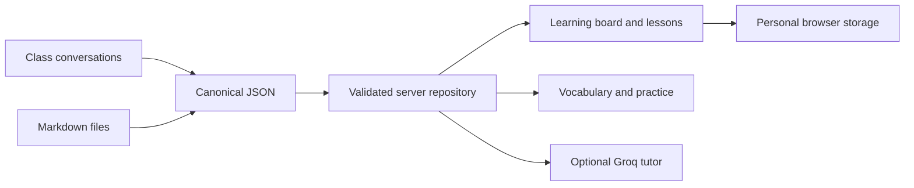

<div align="center">

# HASHIYEH

### A quiet place for connected learning

**Personal learning board · Knowledge graph · Bilingual notes**

[](README.md)
[](README.fa.md)


[Features](#designed-for-the-learning-loop) · [Quick start](#run-and-verify) · [Architecture](#architecture-at-a-glance) · [Deployment](#deployment--boundaries)

</div>



<details>
<summary>Explore the Markdown workspace</summary>



</details>

> A working first edition, built around real class notes.

---

**Hashiyeh is a personal learning workspace that connects what you learn.** A paper-inspired board brings together class notes, related concepts, vocabulary, practice and personal reflections.

### Designed for the learning loop

**Explore → Read → Practice → Reflect → Review**

- **Connected board:** pan and zoom through selected topics; browse all topics in a searchable interface.
- **Source-backed lessons:** read the captured class explanations without silently rewriting the original material.
- **Bilingual Markdown:** independent text direction per block, GFM tables, task lists, fenced code and local Markdown import.
- **Personal workspace:** editable sticky notes, bookmarks, completion state, theme and review scheduling in browser storage.
- **Optional tutor:** a server-side Groq endpoint uses selected lesson notes as context. It needs a configured API key.
- **Responsive motion:** GSAP transitions and React Flow navigation, with reduced-motion support.

### Run and verify

```sh
npm ci
npm run dev            # http://127.0.0.1:3000
npm test               # Data integrity and extraction checks
npm run typecheck      # TypeScript checks
npm run build          # Validate content and build production
npm run test:app       # Production HTTP/auth smoke tests; requires a build
npm start              # Run the production build
```

### Architecture at a glance



| Layer | Location | Responsibility |
| --- | --- | --- |
| Content | `content/`, `schemas/` | Versioned records, relationships and validation |
| Imports | `imports/`, `scripts/` | Captured evidence and explicit import/export workflows |
| Server | `app/lib/repository.ts`, `app/api/` | Protected content access and tutor integration |
| Interface | `app/components/` | Independent board, lesson, notes, review and vocabulary components |
| Presentation | `app/lib/presentation.ts` | Labels, selected graph layout and visual categories |
| Personal state | `app/components/usePersonal.ts` | Versioned browser storage and export |

### Deployment & boundaries

Use a **private GitHub repository** and import it into Vercel with the Next.js preset. Set `SITE_PASSWORD` and a random `SESSION_SECRET` of at least 32 characters. Production content access stays closed until both are configured. Add `GROQ_API_KEY` only in server environment settings; never use a `NEXT_PUBLIC_` prefix for secrets.

Personal notes do **not** synchronize across devices or preview/production domains. Markdown imported in the browser stays local; the CLI import writes canonical repository content. The tutor is contextual assistance, not a complete vector-search/RAG system. Imported educational material remains unreviewed until explicitly checked.

The data contract supports additional subjects; the current interface is configured for English. A second learning room needs subject selection and repository filtering. This is a working foundation, not a claim of showcase-ready completion.

### Project notebook

[Architecture](docs/APP-ARCHITECTURE.md) · [Deployment](docs/DEPLOYMENT.md) · [Markdown](docs/MARKDOWN.md) · [Data contract](docs/DATA-CONTRACT.md) · [Weekly workflow](docs/WEEKLY-WORKFLOW.md) · [Extraction](docs/EXTRACTION.md) · [Conversation index](docs/CHAT-INDEX.md)

---

<div align="center">

**A little every day. A new connection every week.**

[Read in فارسی →](README.fa.md)

</div>
