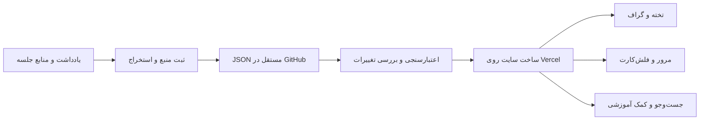

# حاشیه — دفتر یادگیری شخصی

یک فضای مطالعهٔ فارسی با Next.js، React، GSAP و React Flow؛ تختهٔ استیکی‌نوت، نقشهٔ ارتباط مباحث، جزوه‌های واقعی کلاس، واژه‌نامه، تمرین، مرور و یادداشت شخصی. مقصد **GitHub برای کد و محتوا و Vercel برای اجرا** است. مخزن آنلاین و استقرار هنوز ساخته نشده‌اند.

رابط فعلی از ۴۵ مبحث، ۱۹ جلسه و ۱۳۰۳ واژهٔ استخراج‌شده تغذیه می‌شود. هفت تمرین تکمیلی تازه با منشأ `editorial` ثبت شده‌اند؛ این‌ها از متن اصلی استخراج نشده‌اند. [معماری و توسعه](docs/APP-ARCHITECTURE.md) و [راهنمای Vercel](docs/DEPLOYMENT.md) را ببین.

## شروع بررسی

- [متن کامل ۱۰۸ پیام شاخهٔ اصلی](imports/advanced-english-transcript.txt)
- [فهرست ۵۴ نوبت گفت‌وگو و پیوند هر پاسخ](docs/CHAT-INDEX.md)
- [گزارش استخراج و دسته‌بندی](docs/EXTRACTION.md)
- [قرارداد داده و علت انتخاب آن](docs/DATA-CONTRACT.md)
- [روند ثابت جلسات بعدی](docs/WEEKLY-WORKFLOW.md)
- [قالب آمادهٔ یک جلسه](templates/session.bundle.json)
- [فهرست قابل مرور محتوا](docs/CATALOG.md)
- [محدودهٔ دسترسی و داده‌های مفقود](imports/coverage.json)

## اصل معماری

محتوای اصلی JSON نسخه‌دار است. متن هر بخش می‌تواند ساده یا Markdown باشد. نمایش تخته، مختصات کارت‌ها و پیشرفت کاربر از محتوای آموزشی مستقل می‌مانند. گراف، فلش‌کارت، بانک واژگان، متن جزوه و دادهٔ جست‌وجوی هوشمند، خروجی‌های قابل بازسازی این محتوا هستند.



## اجرا

Node.js 22 و npm کافی است:

```sh
npm ci
npm run validate
npm test
npm run dev
```

سایت روی `http://127.0.0.1:3000` اجرا می‌شود. در توسعهٔ محلی ورود لازم نیست. برای ساخت production:

```sh
npm run build
npm run test:app
npm start
```

دستور `test:app` سرور موقت روی پورت ۳۱۰۷ اجرا می‌کند و ورود، حفاظت API، جست‌وجو، جزوه و وضعیت دستیار بدون کلید را بررسی می‌کند. برای ورود production فایل `.env.example` را مطابق راهنمای استقرار تنظیم کن.

```sh
npm run build:data
```

نسخهٔ اصلی گفت‌وگو در مرورگر خوانده و متن ۵۴ پیام کاربر و ۵۴ پاسخ دستیار، همراه ۱۷۲ جدول، در `imports/advanced-english-original.json` حفظ شده است. رکوردهای `src-original-*` منشأ کامل متن و `note-original-*` بخش‌بندی قابل مصرف آن هستند. این capture شاخهٔ فعال است؛ پیوست‌ها، پاسخ‌های جایگزین و متن ابزارهای جداگانه مستقل‌اند. گزارش فنی ورود در `imports/original-chat-import-report.json` قرار دارد.

خروجی محلیِ شامل محتوای شخصی و پیش‌نویس‌ها در `dist/private/` ساخته می‌شود:

| فایل | کاربرد |
|---|---|
| `catalog.json` | رکوردها و ارتباط‌ها، بدون رکوردهای خام منبع |
| `graph.json` | گره‌ها و یال‌های قابل مصرف در رابط گراف |
| `sessions.json` | سابقهٔ جلسات |
| `vocabulary.json` | بانک واژگان با معناها و محل‌های تکرار |
| `flashcards.json` | کارت‌های واژگانی دارای معنی ثبت‌شده |
| `lessons.md` | نمای متنی جزوه‌ها، Writing و اصلاح‌ها |
| `retrieval.ndjson` | متن همراه شناسه و ارجاع، برای ساخت لایهٔ بازیابی |
| `manifest.json` | تعدادها، محدودهٔ خروجی و اثرانگشت داده |

`retrieval.ndjson` هنوز embedding یا سامانهٔ RAG نیست؛ ورودیِ قابل استفاده برای آن است. فلش‌کارت‌ها نیز وضعیت پیش‌نویس و منبع خود را حفظ می‌کنند و ادعای صحت مستقل ندارند.

```sh
npm run build:public-data
```

این فرمان فقط محتوای `published` و `public` را به `dist/public/` می‌برد. در وضعیت فعلی خروجی عمومی خالی است؛ همهٔ محتوا شخصی و بررسی‌نشده است. API و صفحهٔ سایت در production با رمز و کوکی امضاشده محافظت می‌شوند؛ بدون تنظیم رمز و secret، دسترسی بسته می‌ماند. برچسب `private` در فایل، به‌تنهایی دسترسی مخزن GitHub را محدود نمی‌کند؛ مخزن این داده‌های شخصی را private بساز.

## ساختار

```text
content/       # منبع اصلی: هر رکورد یک فایل، هر رابطه یک فایل
imports/       # ردیف‌های استخراج‌شده و گزارش کمبود منابع
schemas/       # JSON Schema برای رکورد و رابطه
templates/     # قرارداد ورودی جلسهٔ بعد
scripts/       # اعتبارسنجی، ورود و ساخت نماهای خروجی
tests/         # صحت ارتباط‌ها و تبدیل‌ها
docs/          # قرارداد و روش کار
```

برای راه‌اندازی Vercel در مرحلهٔ ساخت رابط، مخزن GitHub متصل می‌شود و اعتبارسنجی داده پیش از build سایت اجرا خواهد شد. تغییر پایدار محتوا باید در GitHub ثبت شود؛ نوشتن در فایل‌های runtime سایت جایگزین commit نیست. مطابق [مستندات Vercel برای GitHub](https://vercel.com/docs/git/vercel-for-github)، push و pull request در پروژهٔ متصل می‌توانند deployment ایجاد کنند.

کلید Groq و اعتبارنامهٔ نوشتن GitHub در بخش سرور و متغیرهای محیطی قرار می‌گیرند. این مرحله هیچ اعتبارنامه یا اتصال خارجی ایجاد نمی‌کند.
# Hashieh
